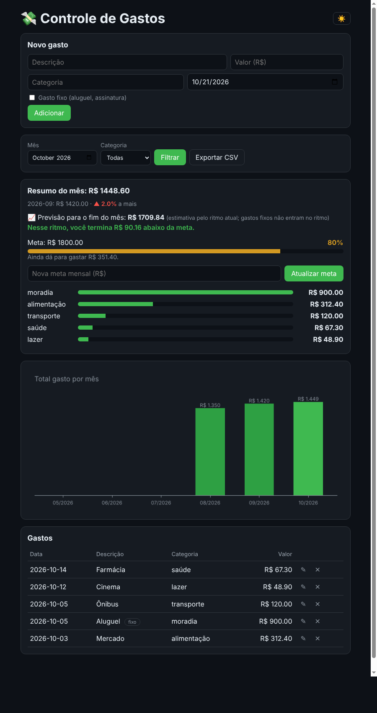
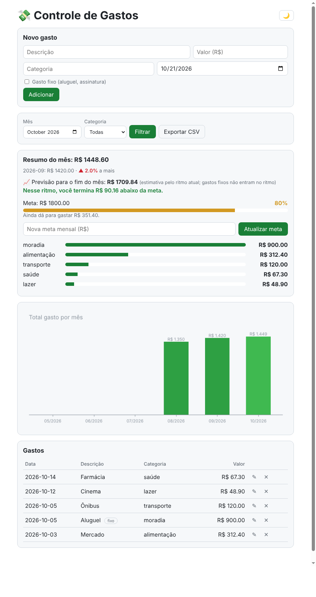

# Controle de Gastos

[](https://github.com/BrunoDS13/project-controle-gastos/actions/workflows/tests.yml)

Aplicação web em Flask para registrar e acompanhar gastos pessoais, com banco SQLite.



<details>
<summary>Ver tema claro</summary>



</details>

## Funcionalidades
- Cadastro de gastos (descrição, valor, categoria e data), com opção de marcar **gasto fixo**
- Edição e remoção de gastos (com confirmação antes de apagar)
- Resumo do mês com total por categoria
- Comparação do total do mês com o mês anterior (variação em %)
- Meta mensal com barra de progresso (verde, amarela e vermelha)
- Previsão do total no fim do mês, pelo ritmo atual de gastos
- Gráfico do total gasto nos últimos 6 meses (matplotlib)
- Filtro por mês e por categoria
- Tema claro e escuro, que lembra a escolha do usuário
- Exportação dos gastos para CSV (respeita o filtro de mês e categoria)
- Testes automatizados com pytest

## Regras de cálculo

**Comparação com o mês anterior**
- `variação = (total do mês − total do mês anterior) ÷ total do mês anterior × 100`
- Se o mês anterior não tem gastos, não há comparação.

**Meta mensal**
- A meta definida em um mês vale também para os meses seguintes, até você definir outra.
- Progresso: **verde** abaixo de 80% da meta, **amarelo** de 80% a 100%, **vermelho** acima de 100%.

**Previsão do fim do mês**
- `previsão = (gastos variáveis ÷ dia atual × dias do mês) + gastos fixos`
- Gastos fixos (aluguel, assinaturas) **não entram no ritmo**, porque acontecem uma vez só. Eles são somados como estão.
- A previsão aparece só no mês em andamento. Meses passados já têm total final, e meses futuros não têm dados.
- Ela só aparece **a partir do dia 7**. Antes disso há poucos dados e o ritmo geraria números exagerados, então a tela mostra um aviso.
- Gastos únicos e grandes que não se repetem devem ser marcados como fixos para não distorcer o ritmo.

**Gráfico**
- Mostra os 6 meses terminando no mês selecionado. Meses sem gastos aparecem com zero.

## Como rodar
```bash
python -m venv .venv
source .venv/bin/activate   # Windows: .venv\Scripts\activate
pip install -r requirements.txt
python app.py
```
Abra http://127.0.0.1:5000 no navegador.

## Configuração
| Variável | Para que serve | Padrão |
|---|---|---|
| `SECRET_KEY` | chave usada pelo Flask para as mensagens da tela. Defina em produção. | aleatória a cada execução |
| `FLASK_DEBUG` | use `1` para ativar o modo debug em desenvolvimento | desligado |

```bash
SECRET_KEY="uma-chave-longa-e-secreta" python app.py
```

## Testes
```bash
pytest
```
Os testes também rodam automaticamente no GitHub Actions a cada push.

## Estrutura
```
app.py              # rotas Flask
.github/workflows/  # testes automáticos (GitHub Actions)
gastos/db.py        # acesso ao banco (SQL)
gastos/grafico.py   # gráfico mensal (matplotlib)
gastos/periodos.py  # cálculo de meses
gastos/previsao.py  # previsão do total do mês
templates/          # páginas HTML
static/             # CSS e JavaScript (tema)
tests/              # testes do banco, dos cálculos e das rotas
docs/               # imagens do README
```

## Tecnologias
Python, Flask, SQLite, matplotlib, HTML, CSS e JavaScript.

## Licença
[MIT](LICENSE)
